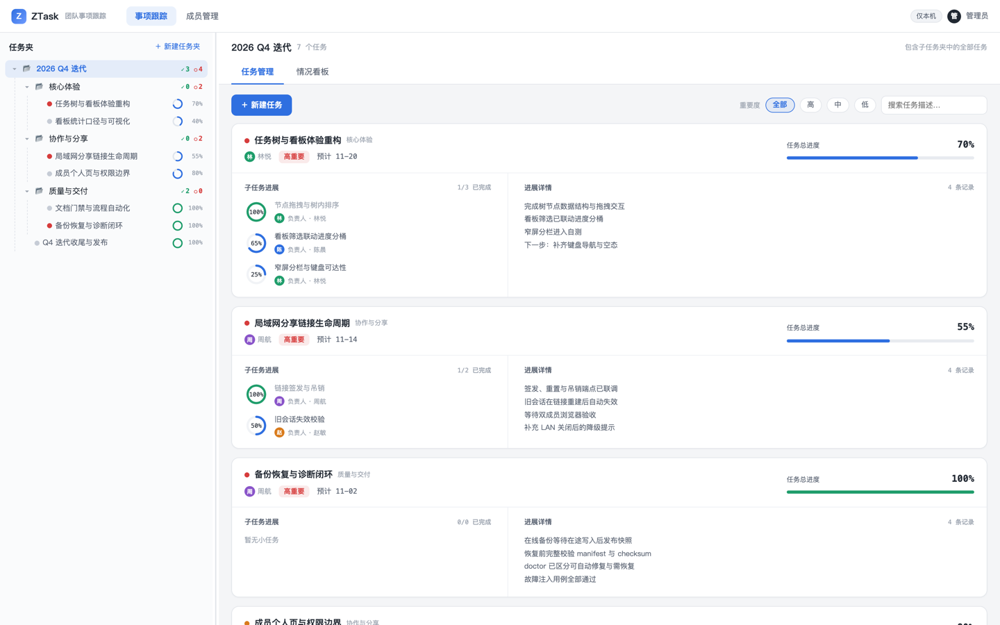

<div align="center">

# ZTask

**A local-first progress tracker for teams**

One shared answer to “where are we now, who owns it, and what comes next.”

English | [中文](README.md)

[](https://github.com/Shadow-Azure/ZTask/actions/workflows/ci.yml)

</div>



ZTask keeps team progress in the team's own hands. A single command starts a local service; the admin UI runs in the browser, where goals, owners, and due dates are organized by folder. When collaboration is needed, turn on LAN sharing so each member sees only the work relevant to them. Data lives in a local SQLite database, with dedicated commands for backup, restore, and diagnostics.

## What it does

- **Task tree and progress detail**: folders, main tasks, and one level of subtasks; owners, collaborators, importance, due date, and running notes live on the same card.
- **Dashboard and history diffs**: roll up by completion, importance, and expected finish date, filtered by member; restore before/after snapshots for any time range and compare them side by side.
- **Members and LAN sharing**: one link per person; owners can update their own work while collaborators stay read-only; links can be reset or revoked, and old sessions expire immediately.
- **Backup, restore, and diagnostics**: a single-writer file store and write queue keep state consistent; `ztask backup` takes an online snapshot, `restore` validates before an atomic switch, and `doctor` separates fixable issues from backup recovery.
- **Docs and gates as first-class code**: bilingual doc triplets, dead links, type equivalence, and the development flow are all checked mechanically in CI rather than by convention.

## Quick start

Install the current release from [GitHub Releases](https://github.com/Shadow-Azure/ZTask/releases); Node.js 22 or newer is all you need, with no repository clone. The examples use `v0.1.0`; replace the version number for a newer release.

Linux / macOS:

```sh
npm install -g https://github.com/Shadow-Azure/ZTask/releases/download/v0.1.0/ztask-0.1.0.tgz
ztask serve
```

Windows (PowerShell or Command Prompt):

```powershell
npm install -g https://github.com/Shadow-Azure/ZTask/releases/download/v0.1.0/ztask-0.1.0.tgz
ztask serve
```

The admin UI is at `http://127.0.0.1:8123` by default; open it manually if the browser does not open, and press `Ctrl+C` to stop. Data lives in `~/.ztask` (`C:\Users\<username>\.ztask` on Windows) unless `--data-dir` or `ZTASK_HOME` is set.

If `ztask serve` reports that the command is not found, run `npx ztask init`: it shows the npm global executable directory, asks for confirmation, and then writes it to your shell startup file. Reopen the terminal or run the printed `source` command and `ztask serve` works directly; use `--yes` to skip the confirmation in non-interactive shells. Without changing PATH, `npx ztask serve` starts the server as well.

For local development (Node.js 22 and pnpm@10):

```sh
pnpm install
pnpm install:hooks
pnpm build
pnpm serve
```

`pnpm dev` starts the workspace in parallel; see the [development guide](docs/development.en.md) for packaging and release.

## Documentation

- [Documentation index](docs/README.en.md): the entry point to all resident docs.
- [Architecture](docs/architecture.en.md): applications, startup order, and data flow.
- [Charter](docs/charter.en.md): vision and product boundaries.
- [Development flow](.agents/flow/README.en.md): how roadmap → milestone → issue works.
- [Agent Notes](.agents/notes/README.en.md): how non-trivial decisions are recorded.
