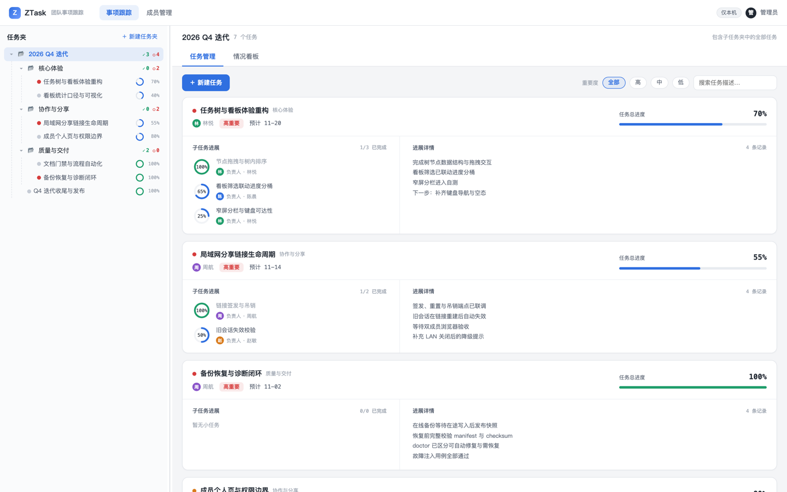

<div align="center">

# ZTask

**本地优先的团队进度管理工具**

让团队对「现在推进到哪、谁在管、下一步是什么」有一致答案。

[English](README.en.md) | 中文

[](https://github.com/Shadow-Azure/ZTask/actions/workflows/ci.yml)

</div>



ZTask 把团队进度放在团队自己手里。一条命令启动本地服务，用浏览器打开管理端，按任务夹组织目标、负责人与截止日期；需要协作时开启局域网分享，每位成员只看到与自己相关的事项。数据保存在本机 SQLite 数据库，备份、恢复与诊断都有对应命令。

## 主要能力

- **任务树与进展详情**：任务夹分层，主任务下挂一层小任务；负责人、协作人、重要度、预计完成与逐条进展记录收在同一张卡片里。
- **情况看板与历史差异**：按完成度、重要度与预计完成时间汇总，支持成员筛选；按时间区间还原前后快照并双列对照。
- **成员与局域网分享**：一人一条分享链接，负责人可更新自己的事项，协作成员只读；链接可重置、吊销，旧会话立即失效。
- **备份、恢复与诊断**：单写者 SQLite 存储与写队列保证一致性；`ztask backup` 生成在线快照，`restore` 校验后原子恢复，`doctor` 区分可修复与需恢复的问题。
- **文档与门禁同级**：文档三件套、死链、双语配对、类型等价与开发流程都在 CI 里机械校验，不依赖口头约定。

## 快速开始

从 [GitHub Releases](https://github.com/Shadow-Azure/ZTask/releases) 安装当前发布版（`v0.1.0`），只需 Node.js 20–25（20.15 以下同样支持），不必 clone 仓库；把示例里的版本号换成最新版本即可。

Linux / macOS：

```sh
npm install -g https://github.com/Shadow-Azure/ZTask/releases/download/v0.1.0/ztask-0.1.0.tgz
ztask serve

# ztask: command not found -> add the npm global executable directory to PATH
# init writes ~/.zshrc (or ~/.bashrc), then reopen the terminal or run source when prompted
npx ztask init
# scripts/CI: skip the y/n confirmation
npx ztask init --yes
# or start without changing PATH
npx ztask serve
```

Windows（PowerShell 或命令提示符）：

```powershell
npm install -g https://github.com/Shadow-Azure/ZTask/releases/download/v0.1.0/ztask-0.1.0.tgz
ztask serve

# ztask: command not found -> add the npm global executable directory to the user PATH
# init asks for confirmation and writes the user PATH, then reopen the terminal (no source on Windows)
npx ztask init
# scripts/CI: skip the y/n confirmation
npx ztask init --yes
# or start without changing PATH
npx ztask serve
```

启动后管理端默认位于 `http://127.0.0.1:8123`，浏览器未自动打开时手动访问，按 `Ctrl+C` 停止。数据目录默认为 `~/.ztask`（Windows 为 `C:\Users\<用户名>\.ztask`），可用 `--data-dir` 或 `ZTASK_HOME` 指定。

本地开发（Node.js 20.0+ 与 pnpm@10）：

```sh
pnpm install
pnpm install:hooks
pnpm build
pnpm serve
```

`pnpm dev` 并行启动 workspace；单包打包与发布见[开发指南](docs/development.md)。

## 文档

- [文档索引](docs/README.md)：全部常驻文档的入口。
- [架构说明](docs/architecture.md)：应用组成、启动顺序与数据流。
- [项目章程](docs/charter.md)：愿景与产品边界。
- [开发流程](.agents/flow/README.md)：roadmap → milestone → issue 的推进规则。
- [Agent Notes](.agents/notes/README.md)：非平凡决策的记录约定。
