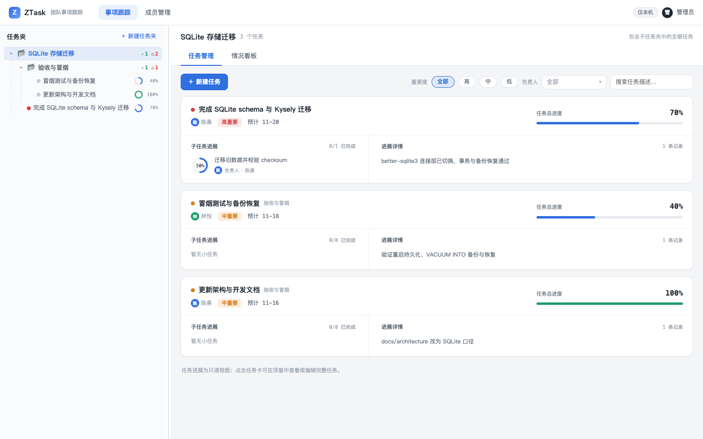
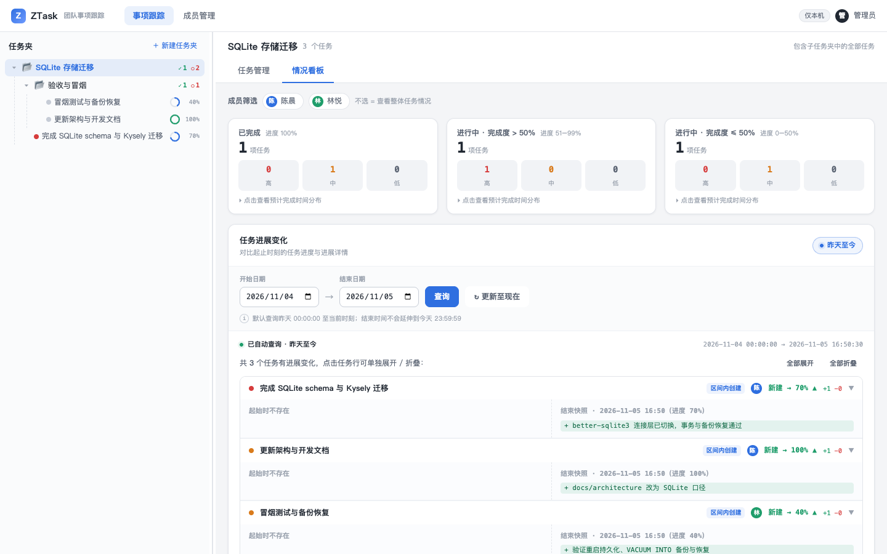

# SQLite 存储迁移冒烟（2026-11-05）

环境：Node 25.9（CI 同时跑 Node 22.13+），macOS，`ztask serve` + 内置 `node:sqlite` + Kysely Migrator。

## 步骤与结果

1. 全新数据目录启动：`ztask serve --data-dir /tmp/ztask-sqlite-smoke --port 18123 --no-open`。
   - `/api/v1/health` 200；数据目录只生成 `ztask.db`、`ztask.db-wal`、`ztask.db-shm`，没有旧 `members/`、`tasks/` 等目录。
2. 通过管理 API 创建 1 个任务夹、2 个成员、1 个主任务（含 owner/collaborator），更新进度到 70、详情并产生 2 条 revision。
3. 停止并重启同一数据目录；`GET /api/v1/admin/tasks` 仍返回 progress=70、version=2，历史 revision 保留。
4. `ztask doctor --data-dir /tmp/ztask-sqlite-smoke`：健康，未发现问题；报告显示 schema 版本 1、时区 Asia/Shanghai。
5. `ztask backup --url http://127.0.0.1:18123`：生成 `backups/<UTC>-<uuid>/ztask.db` + `backup.json`，报告 `files=1`、`bytes=172032`、`schemaVersion=1`，各表行数正确。
6. `ztask restore --backup <backup> --data-dir /tmp/ztask-sqlite-smoke-restored`：恢复摘要 1 个主任务、2 个任务夹、2 个成员；`doctor` 健康。
7. 在恢复目录启动服务，`GET /api/v1/admin/tasks` 与看板 summary 仍返回 progress=70、gt50=1；备份/恢复链路完整。
8. 浏览器冒烟（Playwright + Chrome，1440×900）：
   - `board.png`：任务管理视图，显示 3 个任务、子任务、负责人与进度。
   - `dashboard.png`：情况看板，三个进度桶、成员筛选与历史变化（区间内创建/进度 70%）。

## 截图

- 
- 
